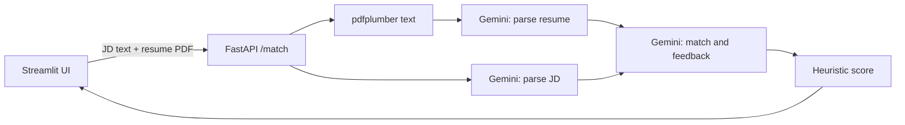

# JobFit AI

Resume-to-job-description matcher. Upload a resume PDF, paste a job description, and get LLM-generated gap feedback, suggested bullet points and a heuristic match score. Prototype built with Streamlit, FastAPI and Google Gemini.

<!-- TODO: screenshot of the Streamlit UI (JD + resume upload and result) -->

 

## Features

- Extracts text from a PDF resume (`pdfplumber`).
- Parses the resume and the job description into structured JSON with Gemini 2.5 Flash.
- Compares the two with an LLM prompt and returns: whether the experience requirement is met, missing required skills, under-emphasized skills, and suggested bullet points to add.
- Rewrites a weak resume bullet on request.
- Streamlit frontend talking to a FastAPI backend.

## How it works



Endpoints in `backend/main.py`: `POST /parse-resume`, `POST /parse-jd`, `POST /match`, `POST /rewrite-bullet`. The LLM calls live in `backend/utils/llm_*.py`, `bullet_rewriter.py` and `ai_suggestions.py`.

The overall score in `backend/utils/score_calculator.py` is a rule-based heuristic: a base of 70, adjusted by whether the years-of-experience requirement is met and by keywords such as "missing" or "not found" in the LLM feedback. It is not a validated or calibrated measure of fit.

## Tech stack

Python 3.11, Streamlit, FastAPI, Uvicorn, pdfplumber, Google Gemini 2.5 Flash (`google-generativeai`).

## Getting started

Prerequisites: Python 3.11 and a Gemini API key from [Google AI Studio](https://aistudio.google.com/).

```bash
python -m venv venv
source venv/bin/activate        # Windows: venv\Scripts\activate
pip install -r requirements.txt
export GEMINI_API_KEY="<your key>"

# terminal 1: backend (the frontend expects http://127.0.0.1:8000)
uvicorn backend.main:app --reload --port 8000

# terminal 2: frontend
streamlit run frontend/app.py
```

Open http://localhost:8501, paste a job description, upload a PDF resume and press "Analyze Fit". Uploaded resumes are saved under `data/resumes/` on the backend host.

Environment variable: `GEMINI_API_KEY` (required).

## Project structure

```
backend/main.py          FastAPI app and /match pipeline
backend/utils/           PDF extraction, Gemini parsers/matcher/rewriter, score heuristic
frontend/app.py          Streamlit UI
requirements.txt         dependencies
Dockerfile, docker-compose.yml  see limitations
```

## Limitations

- Output quality depends entirely on the LLM prompts; no evaluation against labeled data has been done.
- The score is a heuristic over LLM text (see above) and can disagree with the feedback.
- The resume and job description are sent to the Gemini API; do not use confidential documents you cannot share.
- No automated tests and no CI.
- The Dockerfile and `docker-compose.yml` copy from a `jobfit-ai/` subdirectory that does not exist in this repository, so they do not build as-is. Run from source instead.
- `requirements.txt` includes heavy packages (torch, spaCy, sentence-transformers) used only by legacy modules (`backend/utils/matcher.py`, `jd_parser.py`) that the API does not call.
- Not every Gemini call is configured in one place; each util module configures the client itself.

## Roadmap

- Export an optimized resume.
- Persistent storage (currently none; no database).
- Mocked-LLM unit tests and CI.
- Fix the Docker setup and trim unused dependencies.

## License

MIT, see [LICENSE](LICENSE).
